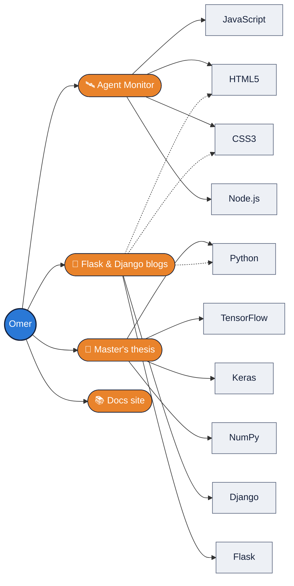

<!-- Header banner: switches with the GitHub light/dark theme, same colours as the portfolio page -->
<picture>
  <source media="(prefers-color-scheme: dark)" srcset="https://capsule-render.vercel.app/api?type=waving&section=header&height=230&color=0:6aa8f0,100:f5a25b&text=Omer%20Parvez&fontColor=0f1729&fontSize=68&fontAlignY=38&desc=Machine%20learning%20%C2%B7%20Python%20back%20ends%20%C2%B7%20Developer%20tooling&descSize=18&descAlignY=60">
  
</picture>

<div align="center">

<picture>
  <source media="(prefers-color-scheme: dark)" srcset="https://readme-typing-svg.demolab.com?font=IBM+Plex+Mono&weight=500&size=19&pause=1400&color=6AA8F0&center=true&vCenter=true&width=700&lines=I+build+tools+that+make+complex+systems+easy+to+see;From+GAN+experiments+to+live+maps+of+AI+agents">
  
</picture>

[](https://omer-parvez.github.io/omer-parvez/)
[](https://omer-parvez.github.io/claude-agent-monitor/)
[](https://github.com/omer-parvez)

</div>

> [!TIP]
> My [portfolio](https://omer-parvez.github.io/omer-parvez/) has a live map: move through it and click an orange node to open that project. Here is the same map:



---

## 🚀 Projects

Real screenshots and code from each repository. Click a screenshot to see it full size.

### 🛰️ [Agent Monitor for Claude Code](https://github.com/omer-parvez/claude-agent-monitor)

See what your Claude Code agents are doing: every session, prompt, subagent and swarm on a live map and timeline, with start and finish times and token counts.

Replay, search and export. Everything stays on your computer, with zero dependencies.

[**▶ Try the live demo**](https://omer-parvez.github.io/claude-agent-monitor/) · [Source](https://github.com/omer-parvez/claude-agent-monitor)

`JavaScript` `Node.js` `HTML/CSS` `Claude Code plugin`

<p align="center">
  <br>
  <sub><b>Replay:</b> a workflow swarm replaying, step by step.</sub>
</p>

<details>
<summary><b>📸 More screenshots:</b> map, timeline, prompt story, dark mode</summary>
<br>

<table>
  <tr>
    <td width="50%" align="center">
      <br>
      <sub><b>Map:</b> who started whom, and what each agent is doing now.</sub>
    </td>
    <td width="50%" align="center">
      <br>
      <sub><b>Timeline:</b> one bar per agent, a tick for every tool call.</sub>
    </td>
  </tr>
  <tr>
    <td width="50%" align="center">
      <br>
      <sub><b>Prompt story:</b> the story of one prompt, from question to answer.</sub>
    </td>
    <td width="50%" align="center">
      <br>
      <sub><b>Dark mode:</b> the same views in dark mode.</sub>
    </td>
  </tr>
</table>

</details>

### 🧬 [Conditional data generation for prostate cancer diagnosis](https://github.com/omer-parvez/GAN)

My master's thesis: using generative adversarial networks (GANs) to generate extra training data, to improve diagnosis in prostate cancer.

Compare a collapsed training run, where every sample comes out the same, with a working DCGAN on Fashion-MNIST.

[Source](https://github.com/omer-parvez/GAN)

`Python` `TensorFlow` `Keras` `GANs` `Jupyter`

<table>
  <tr>
    <th width="50%">❌ Collapsed</th>
    <th width="50%">✅ Working</th>
  </tr>
  <tr>
    <td></td>
    <td></td>
  </tr>
  <tr>
    <td colspan="2" align="center"><sub>Generated samples from two DCGAN training runs.</sub></td>
  </tr>
</table>

<details>
<summary><b>🖼️ Generated tissue</b></summary>
<br>
<p align="center">
  <br>
  <sub>Samples from the generator, in greyscale.</sub>
</p>
</details>

<details>
<summary><b>🧠 Generator code</b> from <code>DCGAN.py</code></summary>

```python
def define_generator(latent_dim):
	model = Sequential()
	# foundation for 7x7 image
	n_nodes = 128 * 7 * 7
	model.add(Dense(n_nodes, input_dim=latent_dim))
	model.add(LeakyReLU(alpha=0.2))
	model.add(Reshape((7,7, 128)))
	# upsample to 14x14
	model.add(Conv2DTranspose(128, (4,4), strides=(2,2), padding='same'))
	model.add(LeakyReLU(alpha=0.2))
	# upsample to 28x28
	model.add(Conv2DTranspose(128, (4,4), strides=(2,2), padding='same'))
	model.add(LeakyReLU(alpha=0.2))
	# generate
	model.add(Conv2D(1, (7,7), activation='tanh', padding='same'))
	return model
```

The generator upsamples random noise into a 28×28 image.
</details>

### 📝 Blogs with Flask and Django

Two blogs built to learn Python web frameworks. The Flask version stores posts in SQLite and lets you create and edit them. The Django version uses the ORM and the built-in admin.

[flask-blog](https://github.com/omer-parvez/flask-blog) · [my-first-blog](https://github.com/omer-parvez/my-first-blog)

`Python` `Flask` `Django` `SQLite` `Jinja2`

<details>
<summary><b>🧪 Flask:</b> <code>app.py</code></summary>

```python
def get_post(post_id):
    conn = get_db_connection()
    post = conn.execute('SELECT * FROM posts WHERE id=?',
                        (post_id,)).fetchone()
    conn.close()
    if post is None:
        abort(404)
    return post

@app.route("/")
def index():
    conn = get_db_connection()
    posts = conn.execute('SELECT * FROM posts').fetchall()
    conn.close()
    return render_template("index.html", posts=posts)
```

Fetch one post, or show a 404 page if it doesn't exist.
</details>

<details>
<summary><b>🎸 Django:</b> <code>models.py</code></summary>

```python
class Post(models.Model):
    author = models.ForeignKey(settings.AUTH_USER_MODEL, on_delete=models.CASCADE)
    title = models.CharField(max_length=400)
    text = models.TextField()
    created_date = models.DateTimeField(default=timezone.now)
    published_date = models.DateTimeField(blank=True, null=True)

    def publish(self):
        self.published_date = timezone.now()
        self.save()

    def __str__(self):
        return self.title
```

A blog post that is saved as a draft until you publish it.
</details>

### 📚 [Documentation site](https://github.com/omer-parvez/docs)

A documentation site built with Mintlify and MDX.

---

## 🛠️ Skills

<!-- Same Devicon icons as the portfolio. Dark logos get a white version in dark mode. Hover an icon to see where I've used it. -->
<table>
  <tr>
    <th align="left">Languages</th>
    <td align="center" width="76"><br><sub>Python</sub></td>
    <td align="center" width="76"><br><sub>JavaScript</sub></td>
    <td align="center" width="76"><br><sub>C++</sub></td>
    <td align="center" width="76"><br><sub>HTML5</sub></td>
    <td align="center" width="76"><br><sub>CSS3</sub></td>
    <td align="center" width="76"><picture><source media="(prefers-color-scheme: dark)" srcset="https://cdn.simpleicons.org/gnubash/white"></picture><br><sub>Shell</sub></td>
    <td align="center" width="76"><picture><source media="(prefers-color-scheme: dark)" srcset="https://cdn.simpleicons.org/latex/white"></picture><br><sub>LaTeX</sub></td>
  </tr>
  <tr>
    <th align="left">ML &amp; data</th>
    <td align="center" width="76"><br><sub>PyTorch</sub></td>
    <td align="center" width="76"><br><sub>TensorFlow</sub></td>
    <td align="center" width="76"><br><sub>Keras</sub></td>
    <td align="center" width="76"><br><sub>scikit-learn</sub></td>
    <td align="center" width="76"><br><sub>NumPy</sub></td>
    <td align="center" width="76"><picture><source media="(prefers-color-scheme: dark)" srcset="https://cdn.simpleicons.org/pandas/white"></picture><br><sub>Pandas</sub></td>
    <td align="center" width="76"><br><sub>SciPy</sub></td>
    <td align="center" width="76"><picture><source media="(prefers-color-scheme: dark)" srcset="https://cdn.simpleicons.org/plotly/white"></picture><br><sub>Plotly</sub></td>
  </tr>
  <tr>
    <th align="left">Web &amp; apps</th>
    <td align="center" width="76"><picture><source media="(prefers-color-scheme: dark)" srcset="https://cdn.simpleicons.org/django/white"></picture><br><sub>Django</sub></td>
    <td align="center" width="76"><picture><source media="(prefers-color-scheme: dark)" srcset="https://cdn.simpleicons.org/flask/white"></picture><br><sub>Flask</sub></td>
    <td align="center" width="76"><br><sub>Node.js</sub></td>
    <td align="center" width="76"><br><sub>React</sub></td>
    <td align="center" width="76"><br><sub>Electron</sub></td>
    <td align="center" width="76"><br><sub>Qt</sub></td>
  </tr>
  <tr>
    <th align="left">Databases</th>
    <td align="center" width="76"><br><sub>MongoDB</sub></td>
    <td align="center" width="76"><br><sub>MySQL</sub></td>
    <td align="center" width="76"><br><sub>SQL Server</sub></td>
  </tr>
  <tr>
    <th align="left">Cloud &amp; DevOps</th>
    <td align="center" width="76"><br><sub>Azure</sub></td>
    <td align="center" width="76"><br><sub>Google Cloud</sub></td>
    <td align="center" width="76"><br><sub>Docker</sub></td>
    <td align="center" width="76"><br><sub>Linux</sub></td>
    <td align="center" width="76"><br><sub>Arduino</sub></td>
  </tr>
</table>

<details>
<summary><b>🔁 Where I've used each skill</b> (the back of the flip tiles on my portfolio)</summary>
<br>

| Skill | Used in |
| --- | --- |
| Python | [Master's thesis](#-conditional-data-generation-for-prostate-cancer-diagnosis), [Flask & Django blogs](#-blogs-with-flask-and-django) |
| JavaScript | [Agent Monitor](#️-agent-monitor-for-claude-code) |
| HTML5 | [Agent Monitor](#️-agent-monitor-for-claude-code), [Flask & Django blogs](#-blogs-with-flask-and-django) |
| CSS3 | [Agent Monitor](#️-agent-monitor-for-claude-code), [Flask & Django blogs](#-blogs-with-flask-and-django) |
| TensorFlow | [Master's thesis](#-conditional-data-generation-for-prostate-cancer-diagnosis) |
| Keras | [Master's thesis](#-conditional-data-generation-for-prostate-cancer-diagnosis) |
| NumPy | [Master's thesis](#-conditional-data-generation-for-prostate-cancer-diagnosis) |
| Django | [Flask & Django blogs](#-blogs-with-flask-and-django) |
| Flask | [Flask & Django blogs](#-blogs-with-flask-and-django) |
| Node.js | [Agent Monitor](#️-agent-monitor-for-claude-code) |

</details>

---

## 📊 GitHub stats

<div align="center">

<picture>
  <source media="(prefers-color-scheme: dark)" srcset="https://github-readme-stats.vercel.app/api?username=omer-parvez&count_private=true&show_icons=true&hide_border=true&bg_color=0f1729&title_color=6aa8f0&icon_color=f5a25b&text_color=e7ecf6">
  
</picture>
<picture>
  <source media="(prefers-color-scheme: dark)" srcset="https://github-readme-stats.vercel.app/api/top-langs/?username=omer-parvez&layout=compact&hide_border=true&bg_color=0f1729&title_color=6aa8f0&text_color=e7ecf6">
  
</picture>

<picture>
  <source media="(prefers-color-scheme: dark)" srcset="https://streak-stats.demolab.com/?user=omer-parvez&hide_border=true&background=0f1729&ring=f5a25b&fire=f5a25b&currStreakLabel=6aa8f0&sideLabels=e7ecf6&currStreakNum=e7ecf6&sideNums=e7ecf6&dates=9aa6bf&stroke=2a3756">
  
</picture>

</div>

---

<div align="center">
<sub>© Omer Parvez. Code on <a href="https://github.com/omer-parvez">github.com/omer-parvez</a></sub>
</div>

<picture>
  <source media="(prefers-color-scheme: dark)" srcset="https://capsule-render.vercel.app/api?type=waving&section=footer&height=120&color=0:6aa8f0,100:f5a25b">
  
</picture>
